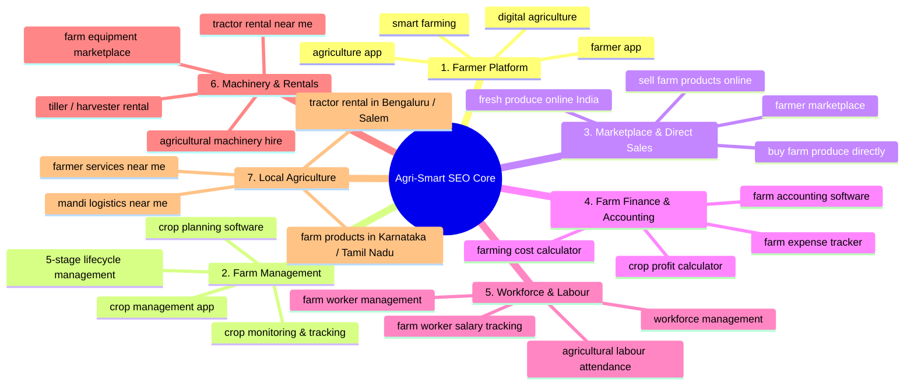

# 🌾 Agri-Smart SEO Master Keyword & Content Strategy

This document serves as the comprehensive SEO reference, keyword taxonomy, page mapping, and technical metadata implementation strategy for the **Agri-Smart** platform.

---

## 🎯 Strategic Summary & Semantic Core

The primary advantage of Agri-Smart in search rankings is **feature-specific, intent-driven semantic clusters** rather than trying to rank solely for broad generic terms like "agriculture" or "farmer".

The platform's unified value proposition combines:
1. **Digital Farm Management & Crop Planning** (stages, irrigation, tracking)
2. **Direct Farmer-to-Consumer / Trader Marketplace** (crops, livestock, organic produce)
3. **Farm Workforce & Daily Attendance Tracker** (wages, attendance, worker directory)
4. **Machinery & Equipment Rental Fleet** (tractors, harvesters, tillers, hourly rates)
5. **Farm Financial Ledger & Profitability Analytics** (expenses, stage costs, net profit)
6. **Hyperlocal / Location-Based Agricultural Services** (near me, state, district, mandi)

---

## 🏛️ 7 Core Keyword Clusters



---

## 📑 Comprehensive Keyword Master Taxonomy

### 1. Core / Primary Keywords
| # | Keyword | Search Intent | Target Page Type |
|---|---|---|---|
| 1 | farmer app | Commercial / Informational | Homepage / Landing |
| 2 | agriculture app | Commercial / Informational | Homepage / Landing |
| 3 | farming app | Commercial / Informational | Homepage / Landing |
| 4 | farmer website | Commercial | Homepage / About |
| 5 | agriculture website | Commercial | Homepage / About |
| 6 | smart farming | Informational | Landing / Features |
| 7 | smart agriculture | Informational | Landing / Features |
| 8 | digital farming | Informational | Landing / Features |
| 9 | digital agriculture | Informational | Landing / Features |
| 10 | agriculture platform | Commercial | About / Platform |
| 11 | farmer platform | Commercial | About / Platform |
| 12 | smart farming platform | Commercial | About / Platform |
| 13 | agriculture management system | High Intent B2B/B2C | Farmer Portal / Features |
| 14 | farmer management system | High Intent B2B/B2C | Farmer Portal / Features |
| 15 | farm management app | High Intent Product | Farmer Dashboard |
| 16 | farm management software | High Intent Product | Farmer Dashboard |
| 17 | digital farm management | Informational / Product | Farmer Dashboard |
| 18 | modern farming technology | Informational | Blog / Feature Overview |
| 19 | agricultural technology | Informational | Blog / Feature Overview |
| 20 | agri tech platform | Commercial | About / Investor / Platform |

---

### 2. Farmer Marketplace Keywords
| # | Keyword | Search Intent | Target Page Type |
|---|---|---|---|
| 21 | farmer marketplace | Commercial / Transactional | `/marketplace` |
| 22 | online farmer marketplace | Commercial / Transactional | `/marketplace` |
| 23 | agriculture marketplace | Commercial / Transactional | `/marketplace` |
| 24 | agricultural marketplace India | High Intent Geo | `/marketplace` |
| 25 | online agriculture marketplace | Transactional | `/marketplace` |
| 26 | farmers market online | Transactional | `/marketplace/produce` |
| 27 | farm products marketplace | Transactional | `/marketplace/produce` |
| 28 | farm produce marketplace | Transactional | `/marketplace/produce` |
| 29 | farmer selling platform | Vendor Acquisition | `/farmer/products` & `/sell` |
| 30 | sell farm products online | Vendor Acquisition | `/sell` / Seller Onboarding |
| 31 | sell agricultural products online | Vendor Acquisition | `/sell` / Seller Onboarding |
| 32 | farmers selling products online | Vendor Acquisition | `/sell` / Seller Onboarding |
| 33 | buy farm products online | High Buyer Intent | `/marketplace` |
| 34 | buy agricultural products online | High Buyer Intent | `/marketplace` |
| 35 | buy directly from farmers | Direct D2C Intent | `/marketplace` |
| 36 | buy farm produce directly from farmers | Direct D2C Intent | `/marketplace/produce` |
| 37 | direct farmer to consumer | D2C Intent | Story / Marketplace |
| 38 | farmer to consumer marketplace | D2C Intent | `/marketplace` |
| 39 | local farmer marketplace | Hyperlocal Intent | `/marketplace?near=me` |
| 40 | online farm produce | Transactional | `/marketplace/produce` |

---

### 3. Fresh Farm Produce Keywords
| # | Keyword | Search Intent | Target Page Type |
|---|---|---|---|
| 41 | farm fresh products | Transactional | `/marketplace/produce` |
| 42 | farm fresh produce | Transactional | `/marketplace/produce` |
| 43 | fresh farm produce online | Transactional | `/marketplace/produce` |
| 44 | fresh agricultural products | Transactional | `/marketplace/produce` |
| 45 | fresh vegetables from farmers | Transactional | `/marketplace/produce?category=vegetables` |
| 46 | fresh fruits from farmers | Transactional | `/marketplace/produce?category=fruits` |
| 47 | local farm produce | Hyperlocal | `/marketplace/produce` |
| 48 | locally grown vegetables | D2C / Health | `/marketplace/produce` |
| 49 | locally grown fruits | D2C / Health | `/marketplace/produce` |
| 50 | fresh produce marketplace | Transactional | `/marketplace/produce` |
| 51 | farmer grown vegetables | High Trust | `/marketplace/produce` |
| 52 | farmer grown fruits | High Trust | `/marketplace/produce` |
| 53 | natural farm produce | Organic / D2C | `/marketplace/produce` |
| 54 | fresh produce online India | India Wide Geo | `/marketplace/produce` |
| 55 | buy fresh farm products | Direct CTA | `/marketplace/produce` |

---

### 4. Crop Management & Agronomy Keywords
| # | Keyword | Search Intent | Target Page Type |
|---|---|---|---|
| 56 | crop management | Informational | `/farmer/crops` |
| 57 | crop management app | High Intent Product | `/farmer/crop-plans` |
| 58 | crop management software | High Intent Product | `/farmer/crop-plans` |
| 59 | crop planning | Informational / Tool | `/farmer/crop-plans` |
| 60 | crop planning app | High Intent Tool | `/farmer/crop-plans` |
| 61 | crop planning software | High Intent Tool | `/farmer/crop-plans` |
| 62 | crop monitoring | Informational / Product | `/farmer/cultivations` |
| 63 | crop monitoring app | High Intent Product | `/farmer/cultivations` |
| 64 | crop tracking | High Intent Product | `/farmer/cultivations` |
| 65 | crop growth tracking | Feature Intent | `/farmer/cultivations` |
| 66 | crop cultivation management | High Intent B2B/Farmer | `/farmer/cultivations` |
| 67 | crop production management | High Intent Farmer | `/farmer/cultivations` |
| 68 | crop schedule | Informational / Guide | `/crops/[slug]/schedule` |
| 69 | farming schedule | Informational | `/crops/[slug]/schedule` |
| 70 | farming schedule app | Tool Intent | `/farmer/crop-plans` |
| 71 | crop calendar | Tool Intent | `/farmer/crop-plans` |
| 72 | digital crop management | High Intent | `/farmer/crops` |
| 73 | crop lifecycle management | Technical Product | `/farmer/cultivations` |
| 74 | crop stage management | Feature Specific (5 Stages) | `/farmer/cultivations` |
| 75 | farm planning software | Software Intent | `/farmer/farms` |

---

### 5. Crop-Specific Programmatic SEO Guides
| Crop | Target Keyword Suite | Programmatic URL Template |
|---|---|---|
| **Onion** | `onion farming`, `onion cultivation`, `onion farming guide`, `onion crop management`, `onion cultivation methods`, `onion farming in India`, `onion crop planning` | `/guides/onion-cultivation-guide` |
| **Tomato** | `tomato farming`, `tomato cultivation`, `tomato farming guide`, `tomato crop management`, `tomato cultivation methods`, `tomato farming in India` | `/guides/tomato-cultivation-guide` |
| **Chilli** | `chilli farming`, `chilli cultivation`, `chilli farming guide`, `chilli crop management`, `chilli cultivation methods`, `chilli farming in India` | `/guides/chilli-cultivation-guide` |
| **Potato** | `potato farming`, `potato cultivation`, `potato farming guide`, `potato crop management`, `potato cultivation methods` | `/guides/potato-cultivation-guide` |
| **Paddy** | `paddy farming`, `paddy cultivation`, `paddy farming guide`, `paddy crop management`, `paddy cultivation methods`, `paddy farming in India` | `/guides/paddy-cultivation-guide` |

---

### 6. Farm Workforce & Labour Management
| # | Keyword | Search Intent | Target Page Type |
|---|---|---|---|
| 76 | farm worker management | High Intent Tool | `/farmer/workers` |
| 77 | farm labour management | High Intent Tool | `/farmer/workers` |
| 78 | agricultural labour management | B2B / Enterprise | `/farmer/workers` |
| 79 | farm worker attendance | High Intent Tool | `/farmer/workers` (Attendance Tab) |
| 80 | farm labour attendance | High Intent Tool | `/farmer/workers` (Attendance Tab) |
| 81 | farm worker attendance app | Product App Intent | `/farmer/workers` |
| 82 | farm worker salary management | Wage / Accounting | `/farmer/workers` (Wages Tab) |
| 83 | farm labour salary management | Wage / Accounting | `/farmer/workers` (Wages Tab) |
| 84 | farm employee management | Tool Intent | `/farmer/workers` |
| 85 | agricultural workforce management | Enterprise Farm | `/farmer/workers` |
| 86 | farm worker tracking | Tool Intent | `/farmer/workers` |
| 87 | farm labour tracking | Tool Intent | `/farmer/workers` |
| 88 | farm workforce management | Tool Intent | `/farmer/workers` |
| 89 | farm worker payment tracking | Financial Tool | `/farmer/workers` |
| 90 | agricultural worker management | Tool Intent | `/farmer/workers` |

---

### 7. Farm Expense & Financial Ledger
| # | Keyword | Search Intent | Target Page Type |
|---|---|---|---|
| 91 | farm expense tracker | High Intent Tool | `/farmer/billing` & `/farmer/reports` |
| 92 | farm expense management | High Intent Tool | `/farmer/billing` |
| 93 | farming expense tracker | High Intent Tool | `/farmer/billing` |
| 94 | agriculture expense management | Financial Tool | `/farmer/billing` |
| 95 | farm income tracker | Revenue Tracking | `/farmer/reports` |
| 96 | farm profit calculator | High Intent Utility | `/tools/farm-profit-calculator` |
| 97 | farming profit calculator | Utility Intent | `/tools/farm-profit-calculator` |
| 98 | crop profit calculator | Utility Intent | `/tools/crop-profit-calculator` |
| 99 | crop expense tracking | Stage Costing | `/farmer/cultivations` |
| 100 | farming cost calculator | Utility Intent | `/tools/farming-cost-calculator` |
| 101 | crop cost calculator | Utility Intent | `/tools/crop-profit-calculator` |
| 102 | farm accounting software | High Value SaaS | `/farmer/billing` |
| 103 | farm financial management | Enterprise SaaS | `/farmer/reports` |
| 104 | agriculture financial management | Financial Solution | `/farmer/reports` |
| 105 | farming income management | Revenue Solution | `/farmer/reports` |

---

### 8. Tractor & Farm Machinery Rental Fleet
| # | Keyword | Search Intent | Target Page Type |
|---|---|---|---|
| 106 | tractor rental | High Transactional | `/farmer/machines` |
| 107 | tractor rental near me | Local Intent | `/machinery/tractor-rental-near-me` |
| 108 | tractor hiring | Transactional | `/farmer/machines` |
| 109 | tractor hire near me | Local Intent | `/machinery/tractor-hire-near-me` |
| 110 | agricultural machinery rental | Commercial | `/farmer/machines` |
| 111 | farm machinery rental | Commercial | `/farmer/machines` |
| 112 | farm equipment rental | Commercial | `/farmer/machines` |
| 113 | agricultural equipment rental | Commercial | `/farmer/machines` |
| 114 | farming equipment near me | Local Intent | `/machinery` |
| 115 | agricultural machinery near me | Local Intent | `/machinery` |
| 116 | tractor services near me | Local Intent | `/machinery` |
| 117 | farm equipment near me | Local Intent | `/machinery` |
| 118 | farming tools near me | Local Intent | `/machinery` |
| 119 | agricultural machinery marketplace | Marketplace | `/farmer/machines` |
| 120 | farm equipment marketplace | Marketplace | `/farmer/machines` |

---

### 9. Hyperlocal SEO & Location Clustering
**State & City Level Programmatic Patterns**:
- `farmer services near me` / `agriculture services near me` / `farming services near me`
- `farm products near me` / `farmers market near me` / `fresh farm produce near me`
- `tractor rental in Bengaluru` / `tractor rental in Salem` / `tractor rental in Coimbatore`
- `farmer marketplace Karnataka` / `farmer marketplace Tamil Nadu`
- `agricultural products in Bengaluru` / `farm produce in Mysuru`

---

### 10. Direct Farmer Crop & Produce Listings
| Crop/Product | High-Conversion Search Queries |
|---|---|
| **Mango** | `fresh mangoes from farmers`, `farm fresh mangoes`, `buy mangoes directly from farmers`, `mangoes online from farmers` |
| **Sapota (Chikoo)** | `fresh sapota from farmers`, `farm fresh sapota`, `buy sapota directly from farmers` |
| **Coconut** | `fresh coconut from farmers`, `farm fresh coconut`, `buy coconut directly from farmers` |
| **Lemon** | `fresh lemon from farmers`, `farm fresh lemon`, `buy lemon directly from farmers` |
| **Drumstick (Murungai)** | `fresh drumstick from farmers`, `fresh murungai from farmers`, `buy drumstick directly from farmers`, `murungai online` |
| **Pomegranate** | `fresh pomegranate from farmers`, `farm fresh pomegranate`, `buy pomegranate directly from farmers` |
| **Country Chicken (Nati Koli)** | `buy nati koli online`, `country chicken directly from farmers`, `fresh country eggs online` |
| **Kangayam Livestock** | `buy kangayam cattle`, `native breed livestock marketplace`, `farm direct goat & sheep` |

---

### 11. Informational & Agronomy Knowledge Base
- `farming tips`, `agriculture tips`, `farming guide`, `agriculture guide`, `farmer information`
- `modern farming techniques`, `smart farming techniques`, `farming methods`, `crop cultivation methods`
- `crop disease information`, `crop pest management`, `crop care guide`, `crop growth guide`
- `agriculture technology`, `farming technology`, `agricultural innovation`, `digital agriculture solutions`

---

### 12. Smart Irrigation & Farm Automation
- `smart irrigation`, `irrigation management`, `farm irrigation system`, `agriculture irrigation`
- `crop irrigation management`, `water management farming`, `precision farming`, `precision agriculture`
- `farm monitoring technology`, `agricultural monitoring system`, `digital farm monitoring`

---

### 13. High-Conversion Long-Tail Questions (Blog & FAQ Targets)
1. *How to manage farm expenses and calculate net harvest profit?*
2. *How to track agricultural labour daily attendance and wage disbursements?*
3. *How to create a multi-stage crop cultivation schedule with irrigation tracking?*
4. *How farmers can sell directly to consumers without middleman commissions?*
5. *How to rent tractors and harvesters locally by the hour or acre?*
6. *Best digital tools for modern Indian farmers and agricultural producers.*

---

## 🗺️ Keyword to Page Mapping Architecture

```
                                [ Agri-Smart Root Domain ]
                                             │
      ┌───────────────────┬──────────────────┴────────────────┬───────────────────┐
      │                   │                                   │                   │
[ Homepage / App ]  [ Marketplace ]                  [ Farmer Portal ]     [ Guides & Tools ]
Main: farmer app    Main: farmer marketplace         Main: farm management Main: crop farming guide
Subs: smart farming Subs: fresh farm produce,        Subs: crop planning,  Subs: profit calculator,
      digital agri        buy directly from farmers        labour, machinery     tractor hire near me
```

| Page Route | Primary Target Keyword | Secondary & Semantic Modifiers |
|---|---|---|
| `/` (Home) | **farmer app** | smart farming, digital agriculture, agriculture platform |
| `/about` | **agriculture platform** | smart farming technology, agri tech ecosystem |
| `/marketplace` | **farmer marketplace** | online farmer marketplace, direct farmer to consumer |
| `/marketplace/produce` | **farm fresh products** | fresh vegetables from farmers, buy directly from farmers |
| `/marketplace/livestock` | **farm fresh poultry & meat** | country chicken online, nati koli, fresh eggs from farmers |
| `/farmer` (Portal) | **farm management app** | digital farm management, farm management software |
| `/farmer/crops` | **crop management app** | digital crop management, crop lifecycle management |
| `/farmer/crop-plans` | **crop planning software** | crop schedule, crop calendar, farming schedule app |
| `/farmer/cultivations` | **crop monitoring & tracking** | crop stage management, 5-stage cultivation cycle |
| `/farmer/workers` | **farm worker management** | farm labour attendance app, farm worker salary tracking |
| `/farmer/machines` | **agricultural machinery rental**| tractor rental, farm equipment marketplace, tractor hire |
| `/farmer/billing` | **farm expense tracker** | farming expense management, farm accounting software |
| `/farmer/reports` | **farm profit calculator** | crop profit calculator, farm income tracker, financial analytics |
| `/guides/[slug]` | **crop cultivation guide** | crop farming in India, disease management, irrigation schedule |

---

## 🛠️ Next.js 14 Technical SEO Architecture

To achieve top SERP rankings with this keyword master list, the frontend implements:

### 1. Dynamic Meta Configuration (`src/app/layout.tsx`)
- Standardized Title Templates: `%s | Agri-Smart Farm Ecosystem`
- Canonical URL generation
- Rich Open Graph (OG) & Twitter card tags
- Keywords meta payload

### 2. Structured Data / Schema.org (`JSON-LD`)
- **SoftwareApplication**: For the Farm Management Web App
- **LocalBusiness / AgriculturalService**: For tractor hiring & machinery services
- **Product & Offer**: For Marketplace Produce & Livestock listings
- **FAQPage & HowTo**: For Agronomy & Crop Cultivation Guides

### 3. Automated Sitemap & Robots (`src/app/sitemap.ts` & `src/app/robots.ts`)
- Dynamically indexing static routes, marketplace categories, and crop guides.
