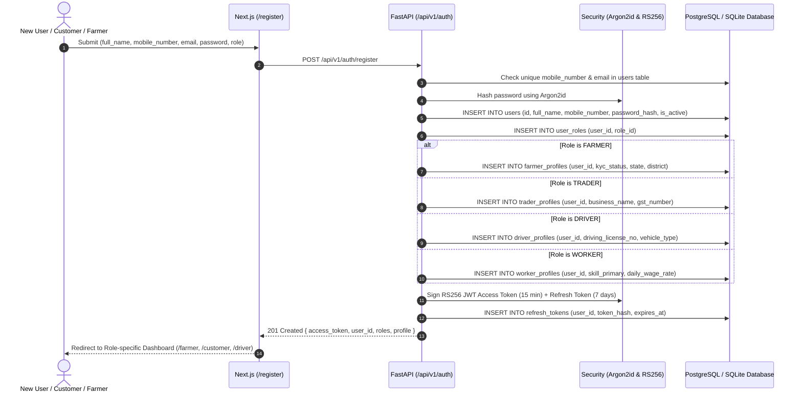
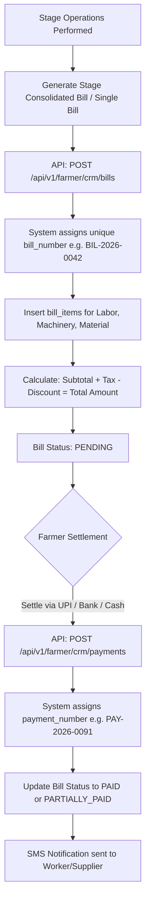
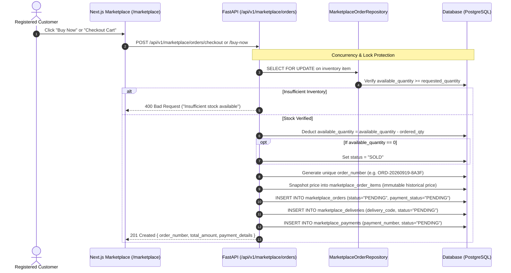
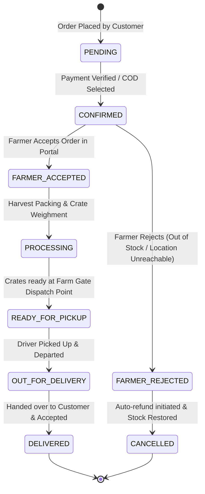
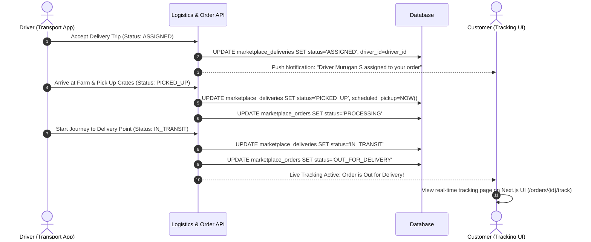
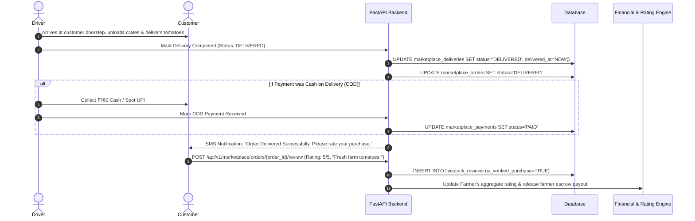
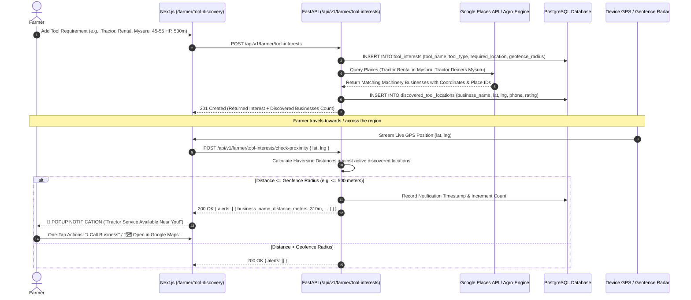

# Agri-Smart Ecosystem — End-to-End Workflow Process Specification

This document details the real, production workflow process of the **Agri-Smart Ecosystem** without mock data. It is grounded directly in the codebase's database models (`SQLAlchemy 2.0`), REST APIs (`FastAPI`), authentication layer (`RS256 JWT`), business services, and frontend state machines (`Next.js App Router`).

---

## 📑 Table of Contents
1. [Actors & Role-Based Access Control (RBAC) Architecture](#1-actors--role-based-access-control-rbac-architecture)
2. [Phase 1: User Registration & Profile Initialization](#2-phase-1-user-registration--profile-initialization)
3. [Phase 2: Farm Setup & Precision Crop Cultivation Lifecycle (Example: Tomato)](#3-phase-2-farm-setup--precision-crop-cultivation-lifecycle-example-tomato)
4. [Phase 3: Farm Operations Billing, Invoicing & Supplier/Worker Settlement](#4-phase-3-farm-operations-billing-invoicing--supplierworker-settlement)
5. [Phase 4: Marketplace Produce Listing & Inventory Ingestion](#5-phase-4-marketplace-produce-listing--inventory-ingestion)
6. [Phase 5: Customer Cart, Direct Buy-Now & Concurrency-Safe Order Creation](#6-phase-5-customer-cart-direct-buy-now--concurrency-safe-order-creation)
7. [Phase 6: Order Invoice Generation & Payment Checkout](#7-phase-6-order-invoice-generation--payment-checkout)
8. [Phase 7: Farmer Acceptance & Order Processing State Machine](#8-phase-7-farmer-acceptance--order-processing-state-machine)
9. [Phase 8: Logistics Dispatch, Driver Assignment & Step-by-Step Live Tracking](#9-phase-8-logistics-dispatch-driver-assignment--step-by-step-live-tracking)
10. [Phase 9: Final Customer Delivery Acceptance, Verified Reviews & Ledger Reconciliation](#10-phase-9-final-customer-delivery-acceptance-verified-reviews--ledger-reconciliation)
11. [End-to-End Visual Process Flowcharts (Mermaid)](#11-end-to-end-visual-process-flowcharts-mermaid)

---

## 1. Actors & Role-Based Access Control (RBAC) Architecture

The platform operates across 6 distinct system roles defined in `app.models.enums.RoleEnum`:

| Role Name | Enum Constant | Database Profile Model | Primary Capabilities |
| :--- | :--- | :--- | :--- |
| **Super Admin** | `SUPER_ADMIN` | `users`, `user_roles` | Full platform governance, master crop catalogue, global metrics, user moderation. |
| **Farmer** | `FARMER` | `farmer_profiles`, `farms` | Farm management, crop cultivation runs, worker attendance, machine tracking, billing, produce/livestock listings, order fulfillment. |
| **Trader** | `TRADER` | `trader_profiles` | Mandi procurement requests, bulk order negotiations, B2B agri-trade. |
| **Driver / Transport** | `DRIVER` | `driver_profiles`, `marketplace_deliveries` | Vehicle registration, trip acceptance, GPS tracking, transit updates, delivery confirmation. |
| **Worker / Laborer** | `WORKER` | `worker_profiles`, `workers` | Skill profiling, daily wage records, attendance logging, wage payment receipts. |
| **Customer** | `CUSTOMER` | `users` | Marketplace browsing, cart management, checkout, digital payments, tracking, verified reviews. |

---

## 2. Phase 1: User Registration & Profile Initialization



---

## 3. Phase 2: Farm Setup & Precision Crop Cultivation Lifecycle (Example: Tomato)

Farmers configure physical farm boundaries and initiate an 8-stage agronomic cultivation run.

### 3.1 Farm Registration & Crop Plan
1. **Create Farm:** Farmer issues `POST /api/v1/farms` with `farm_name`, `total_area`, `area_unit` (`ACRE`), `survey_number`, `soil_type`, and `irrigation_source`.
2. **Crop Selection:** Select Master Crop `Tomato / தக்காளி` (`CropCategory: VEGETABLE`).
3. **Start Cultivation Run:** Issue `POST /api/v1/cultivations` creating a `cultivation_runs` record with `sowing_date`, `estimated_harvest_date`, and `target_yield_kg`.

### 3.2 Tomato Cultivation 8-Stage Progression
The system seeds and tracks the following chronological process stages:

| Stage # | Stage Name | Visual Archetype | Duration | Key Field Activities & Inputs |
| :---: | :--- | :--- | :---: | :--- |
| **1** | **Seed Selection & Priming** | `SEED` | 6 Days | High-germination hybrid seeds, Trichoderma bio-coating, seedling tray preparation. |
| **2** | **Nursery Bed Raising** | `NURSERY` | 25 Days | Raised bed line sowing, shade net shelter, micro-sprinklers, damping-off protection. |
| **3** | **Main Field Transplanting** | `TRANSPLANT` | 7 Days | Ridge & furrow land preparation, FYM incorporation, root dip in bio-fertilizers. |
| **4** | **Vegetative Growth & Foliage** | `VEGETATIVE` | 30 Days | Staking with bamboo sticks, drip fertigation (19:19:19), manual weeding, thrips control. |
| **5** | **Flowering & Fruit Set** | `FLOWERING` | 25 Days | Boron & Calcium foliar sprays, fruit borer pheromone traps, controlled soil moisture. |
| **6** | **Fruit Maturity & Breaker Stage** | `MATURITY` | 15 Days | Potassium-rich fertigation (0:0:50), checking fruit skin firmness and red blush color. |
| **7** | **Harvesting (Multiple Pickings)** | `HARVEST` | 20 Days | Manual hand-picking at breaker/turning stage in cool morning hours into crates. |
| **8** | **Grading, Crate Packing & Yield** | `YIELD_STORAGE` | 5 Days | Grading into Grade-A (table/retail) & Grade-B (processing), plastic crate packing (25kg). |

### 3.3 Dynamic Stage Execution
During each stage, the farmer records:
* **Worker Attendance:** `POST /api/v1/farmer/crm/worker-attendance` (links worker, date, hours, task type, wage calculation).
* **Machinery Usage:** `POST /api/v1/farmer/crm/machine-usage` (tractor ploughing, sprayer operation, fuel costs).
* **Material Purchases:** `POST /api/v1/farmer/crm/material-purchases` (seeds, bio-fertilizers, neem cake).
* **Photo Verification:** `POST /api/v1/media/upload/stage` (upload real field photos with geotag metadata).

---

## 4. Phase 3: Farm Operations Billing, Invoicing & Supplier/Worker Settlement



---

## 5. Phase 4: Marketplace Produce Listing & Inventory Ingestion

Once the crop reaches Stage 7 (Harvest) & Stage 8 (Grading):
1. **Farmer Lists Harvested Produce:**
   - Calls `POST /api/v1/farmer/livestock` (or produce inventory endpoint).
   - Parameters: `title: "Fresh Farm Grade-A Tomatoes (நாட்டு தக்காளி)"`, `selling_model: "QUANTITY"`, `category_id`, `price_per_kg: 35.00`, `available_quantity: 500` (KG), `farm_id`, `harvest_date`, `images`.
   - Initial state: `status = "PUBLISHED"`.

---

## 6. Phase 5: Customer Cart, Direct Buy-Now & Concurrency-Safe Order Creation

Customers browse the public marketplace catalog (`GET /api/v1/marketplace/browse`) and place orders.



---

## 7. Phase 6: Order Invoice Generation & Payment Checkout

### 7.1 Invoice Financial Breakdown
Every order generates an immutable invoice record with the following breakdown:

$$\text{Total Invoice Amount} = \text{Subtotal} + \text{Delivery Charge} + \text{Tax (GST/Cess)} - \text{Discount Amount}$$

**Example (Tomato Purchase):**
* **Ordered Item:** 20 KG Grade-A Tomatoes @ ₹35.00/KG = **₹700.00** (Subtotal)
* **Delivery Charge:** Distance-calculated shipping = **₹60.00**
* **Tax Amount:** 0% on unprocessed fresh vegetables = **₹0.00**
* **Discount:** Promotional code = **-₹0.00**
* **Total Payable Amount:** **₹760.00**

### 7.2 Payment Verification Flow
1. Customer selects `PaymentMethod`: `UPI`, `NET_BANKING`, `CARD`, or `CASH_ON_DELIVERY`.
2. For digital payments (UPI/Gateway), upon transaction completion:
   - Frontend calls `POST /api/v1/marketplace/orders/{order_id}/verify-payment` passing `transaction_reference` and `payment_method`.
3. Backend marks `marketplace_payments.status = "PAID"` and updates `marketplace_orders.payment_status = "PAID"`, setting `marketplace_orders.status = "CONFIRMED"`.
4. System automatically dispatches order confirmation SMS to customer and notification to the farmer.

---

## 8. Phase 7: Farmer Acceptance & Order Processing State Machine



1. **Farmer Portal Notification:** Farmer logs in, sees order in `/farmer/orders` with delivery address, item quantity (e.g. 20 KG Tomatoes), and pickup window.
2. **Acceptance:** Farmer clicks "Accept Order" (`POST /api/v1/farmer/orders/{id}/status` -> `new_status: "FARMER_ACCEPTED"`).
3. **Packaging & Preparation:** Farmer packs tomatoes in ventilated crates, generates crate batch barcode, and marks status as `PROCESSING` then `READY_FOR_PICKUP`.

---

## 9. Phase 8: Logistics Dispatch, Driver Assignment & Step-by-Step Live Tracking

### 9.1 Driver Allocation & Dispatch Creation
When the order is `READY_FOR_PICKUP`:
1. System or Farmer assigns an active driver (`User` with role `DRIVER`) to the delivery entity `marketplace_deliveries`.
2. Driver record contains:
   - `delivery_code`: e.g. `DEL-2026-9901`
   - `vehicle_number`: e.g. `TN-38-AF-4421` (Mini Truck / Pickup Van)
   - `driver_name`: e.g. `Murugan S`
   - `driver_contact`: e.g. `+91 98765 43210`
   - `pickup_location`: Farm Gate, Pollachi, TN
   - `drop_location`: Customer Address, Coimbatore, TN

### 9.2 Step-by-Step Dispatch Progression



---

## 10. Phase 9: Final Customer Delivery Acceptance, Verified Reviews & Ledger Reconciliation



---

## 11. End-to-End Visual Process Flowcharts (Mermaid)

### Comprehensive Master Multi-Actor Workflow

```mermaid
flowchart TD
    subgraph Role Registration & Onboarding
        U1[New User Submits Registration] --> U2[Argon2id Hash & User Profile Creation]
        U2 --> U3{Assigned Role}
        U3 -->|FARMER| R_FARMER[Farmer Profile Created]
        U3 -->|CUSTOMER| R_CUST[Customer Account Ready]
        U3 -->|DRIVER| R_DRIV[Driver Profile & Vehicle Registered]
        U3 -->|WORKER| R_WORK[Worker Skill & Wage Rate Logged]
    end

    subgraph Farm Production Lifecycle
        R_FARMER --> F1[Create Farm & Soil Details]
        F1 --> F2[Initiate Tomato Cultivation Run]
        F2 --> F3[8 Precision Stages: Sowing to Harvesting]
        F3 --> F4[Daily Labor, Machinery & Material Logging]
        F4 --> F5[Generate Internal Farm Bills & Settle Wages]
        F5 --> F6[Harvested Grade-A Tomatoes Packed into Crates]
    end

    subgraph Marketplace & Checkout
        F6 --> M1[Farmer Lists 500 KG Tomatoes @ ₹35/KG]
        R_CUST --> M2[Customer Browses Marketplace & Adds 20 KG]
        M2 --> M3[Concurrency-Protected Checkout with Stock Lock]
        M3 --> M4[Order ORD-XXXX Created & Invoice Generated]
        M4 --> M5[Customer Settles Payment via UPI / Card / COD]
        M5 --> M6[Order Status: CONFIRMED]
    end

    subgraph Fulfillment & Transport
        M6 --> P1[Farmer Accepts Order & Prepares Dispatch]
        P1 --> P2[Status: READY_FOR_PICKUP]
        R_DRIV --> P3[Driver Assigned: DEL-XXXX]
        P3 --> P4[Driver Collects Crates at Farm Gate: PICKED_UP]
        P4 --> P5[In Transit to Destination: OUT_FOR_DELIVERY]
        P5 --> P6[Customer Receives & Inspects Produce: DELIVERED]
    end

    subgraph Settlement & Feedback
        P6 --> S1[Delivery Confirmed & Timestamp Logged]
        S1 --> S2[Customer Submits 5-Star Verified Review]
        S2 --> S3[Escrow Payout Settled to Farmer Account]
        S3 --> S4[Driver Logistics Fee Settled]
    end

    style Role Registration & Onboarding fill:#f0fdf4,stroke:#16a34a,stroke-width:2px
    style Farm Production Lifecycle fill:#eff6ff,stroke:#2563eb,stroke-width:2px
    style Marketplace & Checkout fill:#fefce8,stroke:#ca8a04,stroke-width:2px
    style Fulfillment & Transport fill:#faf5ff,stroke:#9333ea,stroke-width:2px
    style Settlement & Feedback fill:#f0fdfa,stroke:#0d9488,stroke-width:2px
```

---

11. [Phase 10: Tool Demand Registration, Automated Google Places Discovery & GPS Geofencing Proximity Alerts](#phase-10-tool-demand-registration-automated-google-places-discovery--gps-geofencing-proximity-alerts)
12. [End-to-End Visual Process Flowcharts (Mermaid)](#12-end-to-end-visual-process-flowcharts-mermaid)
13. [Database State Table Reference](#13-database-state-table-reference)

---

## Phase 10: Tool Demand Registration, Automated Google Places Discovery & GPS Geofencing Proximity Alerts

To remove the friction of farmers repeatedly and manually searching Google for agricultural machinery (Tractors, Combine Harvesters, Power Tillers, Seeders, Sprayers, Rotavators), Agri-Smart incorporates an autonomous **Tool Interest + Google Places Discovery + GPS Geofencing + In-App Proximity Notification Engine**.



### 10.1 Key Capabilities & Data Entities
* **Tool Demand Registration (`tool_interests`):**
  * `tool_name`: e.g. "Tractor", "Combine Harvester", "Power Tiller", "Power Sprayer".
  * `tool_type`: `RENTAL`, `PURCHASE`, `SERVICE_REPAIR`, `OPERATOR_HIRE`.
  * `required_location`: Target city, district, or taluk (e.g. "Mysuru", "Mandya", "Hassan").
  * `geofence_radius_meters`: Configurable alert radius (default: 500 meters, customizable 200m–2km).
  * `specifications`: Specific requirements (e.g. "45-55 HP, 4WD with rotavator attachment").

* **Automated Google Places Discovery (`discovered_tool_locations`):**
  * Queries Google Places text and nearby search with automated fallbacks to verified agro-machinery dealership directories.
  * Captures business name, category, complete formatted address, precise latitude/longitude coordinates, phone number, Google star rating, and direct Google Maps navigation links.

* **GPS Geofencing Proximity Engine (`POST /api/v1/farmer/tool-interests/check-proximity`):**
  * Continuously evaluates farmer GPS coordinates using the Haversine great-circle formula:
    $$d = 2r \arcsin\left(\sqrt{\sin^2\left(\frac{\Delta \text{lat}}{2}\right) + \cos(\text{lat}_1)\cos(\text{lat}_2)\sin^2\left(\frac{\Delta \text{lng}}{2}\right)}\right)$$
  * Compares live distance $d$ against the user's geofence threshold ($d \le 500\text{ m}$).
  * Manages notification cooldowns to prevent repeat spam.

* **Interactive In-App 🔔 Popup Notification Modal:**
  * Animated radar beacon and audio synthesizer chime.
  * Direct one-tap click-to-call (`tel:`) and Google Maps directions navigation.

---

## 12. End-to-End Visual Process Flowcharts (Mermaid)

```mermaid
graph TD
    subgraph Role Registration & Onboarding
        U1[New User Registers at /register] --> U2{Select Ecosystem Role}
        U2 -->|Role: FARMER| R_FARM[Farmer Profile: KYC, District, Land Holdings]
        U2 -->|Role: TRADER| R_TRAD[Trader Profile: Business Name, APMC GSTIN]
        U2 -->|Role: DRIVER| R_DRIV[Driver Profile: Driving License, Vehicle Details]
        U2 -->|Role: WORKER| R_WORK[Worker Profile: Labor Skill, Daily Wage]
        U2 -->|Role: CUSTOMER| R_CUST[Customer Profile: Marketplace Buyer]
    end

    subgraph Tool Interest & Geofenced Discovery
        R_FARM --> T1[Farmer Adds Tool Requirement: Tractor / Mysuru / 500m]
        T1 --> T2[Automatic Google Places Search Queries]
        T2 --> T3[Store Matching Businesses & Coordinates in DB]
        T3 --> T4[Farmer Travels Across Region]
        T4 --> T5{GPS Distance <= 500m?}
        T5 -->|Yes| T6[🔔 POPUP ALERT: Tractor Service Available Near You!]
        T6 --> T7[One-Tap Call / Google Maps Navigation]
    end

    subgraph Farm Production Lifecycle
        R_FARM --> F1[Create Farm: Land Area, Survey No, Soil Type]
        F1 --> F2[Select Master Crop: Tomato / Vegetable]
        F2 --> F3[Initiate Cultivation Run: 8 Agronomic Stages]
        F3 --> F4[Stage Execution: Worker Attendance & Machinery Logs]
        F4 --> F5[Final Stage: Harvest Grading & Crate Packing]
    end

    subgraph Marketplace & Checkout
        F5 --> M1[Farmer Lists Harvest Produce / Livestock]
        R_CUST --> M2[Customer Explores Fresh Store & Adds to Cart]
        M2 --> M3[Concurrency-Safe Direct Checkout / Buy Now]
        M3 --> M4[Order ORD-XXXX Created & Invoice Generated]
        M4 --> M5[Customer Settles Payment via UPI / Card / COD]
        M5 --> M6[Order Status: CONFIRMED]
    end

    subgraph Fulfillment & Transport
        M6 --> P1[Farmer Accepts Order & Prepares Dispatch]
        P1 --> P2[Status: READY_FOR_PICKUP]
        R_DRIV --> P3[Driver Assigned: DEL-XXXX]
        P3 --> P4[Driver Collects Crates at Farm Gate: PICKED_UP]
        P4 --> P5[In Transit to Destination: OUT_FOR_DELIVERY]
        P5 --> P6[Customer Receives & Inspects Produce: DELIVERED]
    end

    subgraph Settlement & Feedback
        P6 --> S1[Delivery Confirmed & Timestamp Logged]
        S1 --> S2[Customer Submits 5-Star Verified Review]
        S2 --> S3[Escrow Payout Settled to Farmer Account]
        S3 --> S4[Driver Logistics Fee Settled]
    end

    style Role Registration & Onboarding fill:#f0fdf4,stroke:#16a34a,stroke-width:2px
    style Tool Interest & Geofenced Discovery fill:#fdf4ff,stroke:#a855f7,stroke-width:2px
    style Farm Production Lifecycle fill:#eff6ff,stroke:#2563eb,stroke-width:2px
    style Marketplace & Checkout fill:#fefce8,stroke:#ca8a04,stroke-width:2px
    style Fulfillment & Transport fill:#faf5ff,stroke:#9333ea,stroke-width:2px
    style Settlement & Feedback fill:#f0fdfa,stroke:#0d9488,stroke-width:2px
```

---

## 13. Database State Table Reference

For developers and operations teams, the exact database entity states across this workflow are summarized below:

| Workflow Stage | `marketplace_orders.status` | `marketplace_payments.status` | `marketplace_deliveries.status` | `livestock / produce.status` | `tool_interests.status` |
| :--- | :--- | :--- | :--- | :--- | :--- |
| **1. Tool Demand Registered** | — | — | — | — | `ACTIVE` |
| **2. Places Discovered & Stored** | — | — | — | — | `ACTIVE` (Locations populated) |
| **3. Proximity Triggered (<500m)** | — | — | — | — | `ACTIVE` (Proximity alert generated) |
| **4. Listed on Store** | — | — | — | `PUBLISHED` | — |
| **5. Cart Checkout (Locked)** | `PENDING` | `PENDING` | `PENDING` | `PUBLISHED` (Qty deducted) / `SOLD` | — |
| **6. Payment Verified** | `CONFIRMED` | `PAID` | `PENDING` | `SOLD` (if qty = 0) | — |
| **7. Farmer Accepted** | `FARMER_ACCEPTED` | `PAID` | `PENDING` | `SOLD` | — |
| **8. Packaging Complete** | `READY_FOR_PICKUP` | `PAID` | `ASSIGNED` | `SOLD` | — |
| **9. Driver Picked Up** | `PROCESSING` | `PAID` | `PICKED_UP` | `SOLD` | — |
| **10. En Route** | `OUT_FOR_DELIVERY` | `PAID` | `IN_TRANSIT` | `SOLD` | — |
| **11. Final Delivery** | `DELIVERED` | `PAID` | `DELIVERED` | `SOLD` | — |
| **12. Cancelled / Refunded** | `CANCELLED` | `REFUNDED` | `CANCELLED` | `PUBLISHED` (Stock restored) | — |

---
*Document auto-generated from live Agri-Smart Ecosystem codebase schemas and service architecture.*
