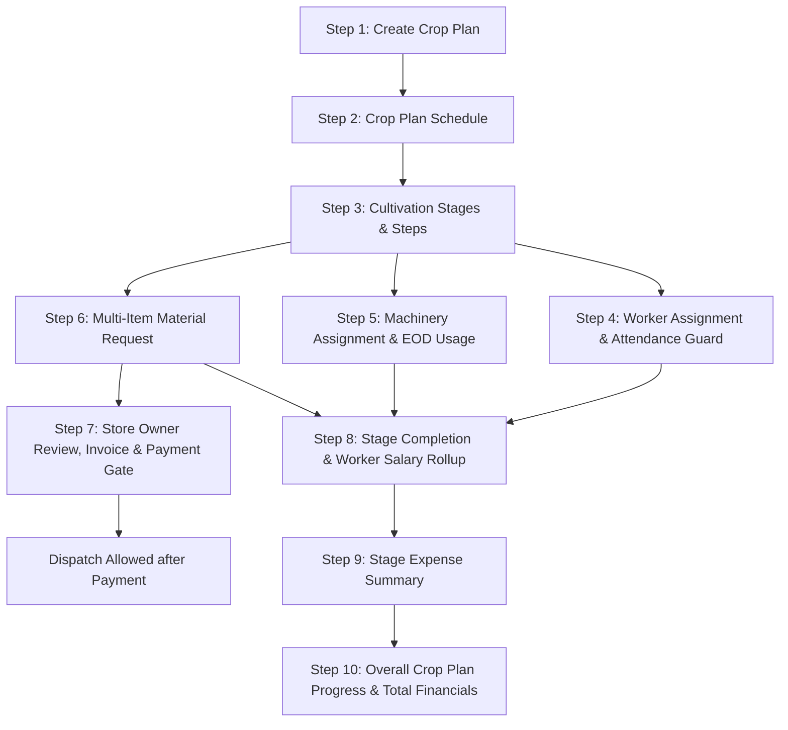

# Implementation Plan – Simplify Farm Workflow & Mobile Responsive UI

## 1. Overview & Objective

The objective is to simplify and streamline the **Agri-Smart Ecosystem** farm cultivation lifecycle into an intuitive, sequential, 10-step process:

```text
1. Crop Plan
      ↓
2. Crop Plan Schedule
      ↓
3. Cultivation Stages (Stage → Step → Work)
      ↓
4. Worker Assignment (Search & Reuse Worker Master)
      ↓
5. Machinery Assignment (Fixed Rental Rates & EOD Work Usage)
      ↓
6. Materials / Input Purchase (Vendor → Category → Product multi-item cart + GST)
      ↓
7. Store Owner Order Management (Confirm → Invoice → Payment Gate → Dispatch)
      ↓
8. Stage Completion & Worker Salary Calculation (Attendance Guarded by Date)
      ↓
9. Stage Expense Ledger Rollup (Labour + Machinery + Materials + Others)
      ↓
10. Crop Progress & Overall Plan Financial Rollup
```

We will preserve all existing working models and APIs, strictly eliminate mock/hardcoded data, enforce database constraints and RBAC, and deliver a clean, mobile-first responsive user interface with touch-friendly cards, collapsible sections, and sticky action bars.

---

## 2. User Review Required

> [!IMPORTANT]
> **Attendance Date Guard Enforcement**: Worker attendance cannot be finalized or marked for dates in the future relative to the scheduled work/completion date. The frontend and backend will strictly enforce `work_date <= today`.
>
> **Rental Machinery Fixed-Rate Guard**: Rental rates per hour/day are locked upon assigning the machine to a stage/step. During EOD entry, users can only record actual usage (hours/time) and work notes; arbitrary rate tampering is blocked.
>
> **Payment Before Dispatch**: For store owner material purchases and marketplace dispatches, the `Dispatch` action will be hard-blocked until payment confirmation is verified (`status == "PAID"`).

---

## 3. Existing Architecture vs. Simplified Design

| Layer | Existing Implementation | Proposed Simplified & Mobile-Responsive Flow |
|---|---|---|
| **Crop Plan Creation** | [`FarmCropPlanForm.tsx`](file:///e:/own_project/startup_farms/frontend/src/components/crop-plans/FarmCropPlanForm.tsx) with multi-section desktop form | Clean, streamlined card form with mobile-first inputs, instant "Continue to Schedule" button |
| **Schedule View** | Basic table / loose tab | Dynamic timeline card with live progress bar (e.g. `25%`), duration counter, days elapsed |
| **Stages & Steps** | Flat stage list with complex pre-activity widgets | Hierarchical `Stage → Step → Work` builder with quick-add actions (`+ Add Stage`, `+ Add Step`) |
| **Worker Management** | Master in [`Worker`](file:///e:/own_project/startup_farms/backend/app/models/worker.py), logs in [`WorkerAttendance`](file:///e:/own_project/startup_farms/backend/app/models/worker_attendance.py) | 1-Click Worker search & reuse from master, wage rate assignment, date-guarded attendance modal |
| **Machinery Usage** | Master in [`Machine`](file:///e:/own_project/startup_farms/backend/app/models/machine.py), usages in [`MachineUsage`](file:///e:/own_project/startup_farms/backend/app/models/machine_usage.py) | Reusable machine picker, fixed rate locking, EOD log (`Hours × Rate = Total Cost`) |
| **Material Purchases** | Single-item procurement / basic purchase forms | Multi-item purchase requisition with dependent `Vendor → Category → Product` dropdowns, auto unit prices, and GST % calculation |
| **Store Owner Workflow** | Scattered procurement requests | Consolidated Store Owner Order Dashboard: `New → Confirmed → Invoice Generated → Paid → Ready for Dispatch → Dispatched` |
| **Stage Completion & Salary** | Manual status change | Verification checklist: verify worker attendance, auto-compute individual salary + total labour cost |
| **Expense Rollup** | Scattered ledger lines | Itemized Stage Summary (`Workers + Machinery + Materials + Others = Stage Total`) and Cumulative Crop Plan Cost |
| **Mobile Layout** | Horizontal table overflows on small screens | Pure card-based responsive views, sticky bottom actions, large touch targets (48px+), zero horizontal scrolling |

---

## 4. Detailed Step-by-Step Workflow Blueprint



### Step 1: Add Crop Plan
- **Inputs**: Farm Parcel, Crop, Season (Kharif/Rabi/Zaid/Navarai/Samba/Thaladi), Planned Area, Land Area Unit (Acre/Cent/Hectare/Guntha), Planned Start Date, Expected Harvest Date, Planning Notes.
- **Action**: Saving transitions directly to **Step 2: Schedule**.

### Step 2: Crop Plan Schedule
- **Display**: Crop badge, Farm holding name, Sowing Date, Expected Harvest Date, Calculated Duration (e.g. `120 Days`), and Overall Progress Indicator (`████░░░░ 25%`).
- **Action**: Button to proceed to **Step 3: Cultivation Stages**.

### Step 3: Cultivation Stages & Steps (Stage → Step → Work)
- **Hierarchy**:
  ```text
  Stage 1: Land Preparation
    ├── Step 1.1: Ploughing (Tractor / Bull cart)
    ├── Step 1.2: Levelling
    └── Step 1.3: Bed & Ridge Preparation
  Stage 2: Seed Sowing & Planting
    ├── Step 2.1: Seed Treatment
    ├── Step 2.2: Sowing / Nursery Transplanting
    └── Step 2.3: Initial Irrigation
  Stage 3: Weeding & Intercultural Operations
  Stage 4: Fertilization & Spraying
  Stage 5: Maturation & Harvesting
  ```
- **Actions**: `+ Add Stage` and `+ Add Step` inline modals without bloated nested forms.

### Step 4: Add Workers & Enforce Attendance Date Rule
- **Worker Reuse**: Search worker from existing Worker Master by name, skill, or mobile number without creating duplicate records.
- **Assignment**: Worker, Work Type, Stage, Step, Planned Date, Wage Type (Daily/Hourly/Piece), Wage Rate.
- **Attendance Date Guard**:
  - `work_date > today` ➔ **BLOCKED**: Attendance cannot be finalized ahead of time.
  - `work_date <= today` ➔ **ALLOWED**: Status `PRESENT` (1.0 day), `HALF_DAY` (0.5 day), `ABSENT` (0.0 day), `LEAVE`.
  - Wage auto-computed: `Working Days × Daily Salary + Overtime = Total Amount`.

### Step 5: Machinery Assignment & EOD Rental Rule
- **Machinery Reuse**: Select owned or rented machinery (Tractor, Power Tiller, Weeder, Harvester, Water Pump).
- **Rental Rate Locking**: Rate per hour / day is recorded upon assignment.
- **EOD Log Entry**:
  - Farmer logs `Actual Start Time`, `Actual End Time`, `Total Hours Worked`, `Operator Cost`, `Fuel Cost`, and work notes.
  - `Total Machinery Cost = (Hours Worked × Fixed Hourly Rate) + Fuel Cost + Operator Cost`.

### Step 6: Multi-Item Material / Input Purchase Request
- **Dependent Filtering**:
  ```text
  Select Vendor (Supplier Master)
        ↓
  Select Category (Seed / Fertilizer / Pesticide / Organic Manure / Tool)
        ↓
  Select Product / Item (Input Master with Unit Rate & Standard Unit)
        ↓
  Enter Quantity (e.g. 5 Bags) ➔ Unit Price ➔ GST % (e.g. 5%, 12%, 18%)
        ↓
  [+ Add Another Item] (Multi-item cart inside requisition)
  ```
- **Live Calculations**:
  - `Subtotal = Sum(Quantity × Unit Price)`
  - `GST Amount = Sum(Item Subtotal × (GST % / 100))`
  - `Grand Total = Subtotal + GST Amount`

### Step 7: Store Owner Workflow & Payment-Before-Dispatch Gate
- **Store Owner Console**: View incoming material requests with itemized breakdown.
- **Actions**:
  1. Confirm / Modify Available Quantities
  2. Generate Proforma / Official Tax Invoice
  3. Prepare Order & Pack
  4. Create Logistics / Shipment Details (Address, Carrier, Tracking No)
  5. **Payment Check**:
     - If `bill.status != "PAID"`, the **Dispatch** button is disabled with message: `"⚠️ Payment Required Before Dispatch"`.
     - Farmer pays online (UPI / Net Banking / Cash Receipt Verified).
     - Once `Payment Verified` ➔ `Dispatch` button activates ➔ Status moves to `DISPATCHED` ➔ `DELIVERED`.

### Step 8: Stage Completion & Worker Salary Rollup
- When farmer clicks `Complete Stage`:
  1. Verifies all assigned workers have logged attendance.
  2. Generates individual worker wage breakdown:
     - Worker Name, Attendance Days, Wage Rate, Total Amount, Payment Status (`PAID` / `PENDING`).
  3. Calculates **Total Stage Labour Cost**.

### Step 9: Stage Expense Summary
- Visual expense card compiling real database records:
  ```text
  Stage Cost Summary (Stage 1: Land Preparation)
  -----------------------------------------------
  Labor / Workers (3 workers)        : ₹1,700.00
  Machinery (Tractor 4 hrs @ ₹800)   : ₹3,200.00
  Materials / Inputs (Manure & Seed) : ₹2,500.00
  Other Field Expenses               :   ₹500.00
  -----------------------------------------------
  Total Stage Expense                : ₹7,900.00
  ```

### Step 10: Overall Crop Plan Cost & Progress
- Cumulative dashboard aggregating all stages:
  - Total Labour Cost
  - Total Machinery Cost
  - Total Material Cost
  - Total Cultivation Cost
  - Completed Stages count vs. Pending Stages count
  - Progress percentage bar

---

## 5. Proposed Code Changes

### Backend Changes

#### [MODIFY] [`backend/app/models/cultivation.py`](file:///e:/own_project/startup_farms/backend/app/models/cultivation.py)
- Enhance `CultivationStage` to support nested `steps` (parent-child step structure or stage sub-steps stored cleanly in database table/JSON relationships).

#### [MODIFY] [`backend/app/schemas/farmer_crm.py`](file:///e:/own_project/startup_farms/backend/app/schemas/farmer_crm.py)
- Add multi-item material purchase request schema `MultiItemMaterialPurchaseCreate` supporting `items: List[PurchaseItemPayload]`, `gst_percent`, and `vendor_id`.
- Add stage step schema `CultivationStageStepCreate`, `CultivationStageStepResponse`.
- Add strict validation to `WorkerAttendanceCreate` requiring `work_date <= date.today()`.

#### [MODIFY] [`backend/app/services/farmer_crm_service.py`](file:///e:/own_project/startup_farms/backend/app/services/farmer_crm_service.py)
- Add `create_multi_item_purchase` to create purchase records with itemized bills and tax breakdowns.
- Update `add_worker_attendance` to enforce work date validation against future dates.
- Add `get_stage_labour_summary` and `get_stage_complete_cost_summary`.

#### [MODIFY] [`backend/app/api/v1/farmer_crm.py`](file:///e:/own_project/startup_farms/backend/app/api/v1/farmer_crm.py)
- Expose `/farmer/crm/purchases/multi-item` endpoint for multi-item material purchases.
- Expose `/farmer/crm/stages/{stage_id}/cost-summary` for real-time stage cost rollup.

---

### Frontend Changes

#### [NEW] [`frontend/src/components/cultivations/StageStepManager.tsx`](file:///e:/own_project/startup_farms/frontend/src/components/cultivations/StageStepManager.tsx)
- Modular component rendering the sequential `Stage → Step → Work` hierarchy with quick modal triggers for adding stages, adding steps, assigning workers, and assigning machinery.

#### [NEW] [`frontend/src/components/farmer/MultiItemMaterialPurchaseModal.tsx`](file:///e:/own_project/startup_farms/frontend/src/components/farmer/MultiItemMaterialPurchaseModal.tsx)
- Multi-item material purchase dialog with dependent `Vendor → Category → Product` cascading dropdowns, dynamic line-item addition (`+ Add Another Item`), and live GST % + Grand Total calculations.

#### [NEW] [`frontend/src/components/farmer/StoreOwnerOrderConsole.tsx`](file:///e:/own_project/startup_farms/frontend/src/components/farmer/StoreOwnerOrderConsole.tsx)
- Store Owner requisition console supporting status transitions (`New → Confirmed → Preparing → Invoiced → Payment Gate → Ready for Dispatch → Dispatched`). Enforces the "Payment Required Before Dispatch" guard.

#### [NEW] [`frontend/src/components/cultivations/StageCompletionSummaryModal.tsx`](file:///e:/own_project/startup_farms/frontend/src/components/cultivations/StageCompletionSummaryModal.tsx)
- Comprehensive stage completion modal verifying worker attendance, displaying individual worker salaries, and providing the itemized expense breakdown (Labor, Machinery, Materials, Others).

#### [MODIFY] [`frontend/src/app/farmer/cultivations/[cultivationId]/page.tsx`](file:///e:/own_project/startup_farms/frontend/src/app/farmer/cultivations/%5BcultivationId%5D/page.tsx)
- Transform the Cultivation Console into the streamlined, mobile-responsive step-based workflow UI.
- Replace heavy desktop tables on mobile with card-based layouts and touch-friendly controls.
- Add sticky bottom action bar on mobile viewports for seamless navigation (`[+ Add Stage]`, `[+ Add Worker]`, `[+ Add Machinery]`, `[+ Add Material]`, `[Complete Stage]`).

#### [MODIFY] [`frontend/src/components/crop-plans/FarmCropPlanForm.tsx`](file:///e:/own_project/startup_farms/frontend/src/components/crop-plans/FarmCropPlanForm.tsx)
- Streamline fields into clear, simple sections with responsive inputs and direct "Save & Continue to Schedule" button.

#### [MODIFY] [`frontend/src/app/farmer/crop-plans/[planId]/page.tsx`](file:///e:/own_project/startup_farms/frontend/src/app/farmer/crop-plans/%5BplanId%5D/page.tsx)
- Add the interactive Crop Plan Schedule & Duration Tracker card with direct one-click action to launch Cultivation Stages.

---

## 6. Mobile Responsiveness Design System

```text
Desktop Layout (>= 1024px)
┌────────────────────────────────────────────────────────┐
│ Crop Plan & Schedule Header                            │
├────────────────────────────────────────────────────────┤
│ Stage 1 [Steps | Workers | Machinery | Materials]      │
├────────────────────────────────────────────────────────┤
│ Labour Cost | Machinery Cost | Material Cost | Total   │
└────────────────────────────────────────────────────────┘

Mobile Layout (< 768px)
┌───────────────────────────┐
│ 🌾 Onion (Main Farm)      │
│ Progress: 45% (Day 30/120)│
├───────────────────────────┤
│ ▼ Stage 1: Land Prep  ✓   │
│   • 3 Workers (₹1,700)    │
│   • 1 Tractor (₹3,200)    │
│   • Total: ₹7,900         │
│   [View Details]          │
├───────────────────────────┤
│ ▶ Stage 2: Sowing (Active)│
│   • 2 Workers Assigned    │
│   • 1 Machine Assigned    │
│   [+ Work] [+ Log]        │
├───────────────────────────┤
│ ── STICKY BOTTOM ACTIONS ─│
│ [+ Worker] [+ Machine] [✓]│
└───────────────────────────┘
```

1. **Card-Based Lists**: All data tables transform to structured cards on mobile (`< 768px`) with clear badge indicators and primary metrics highlighted.
2. **Touch Targets**: All buttons, select menus, and inputs maintain a minimum height of `44px-48px` with appropriate touch spacing.
3. **No Horizontal Scroll**: Text is cleanly truncated or line-wrapped; numeric badges and pills remain bounded within viewport.
4. **Sticky Bottom Actions**: On mobile cultivation views, key actions (`+ Worker`, `+ Machine`, `+ Material`, `Complete Stage`) remain accessible in a floating/sticky bottom bar.

---

## 7. Verification Plan

### Automated Backend Tests
- Run `pytest` across all test suites:
  - Worker attendance date-guard tests (verifying error on future date).
  - Machinery rental fixed rate calculation tests.
  - Multi-item material purchase with GST calculation tests.
  - Payment-before-dispatch status enforcement tests.
  - Stage labor and total expense aggregation tests.

### Automated Frontend Type Checking
- Run `npx tsc --noEmit` on `frontend/` to ensure 0 TypeScript errors.

### Manual End-to-End Flow Verification
1. Create a Farm & Crop Plan with start and harvest dates.
2. Verify Crop Plan Schedule displays accurate duration and progress.
3. Add Cultivation Stages and nested Steps (`Stage 1: Land Preparation → Step 1.1: Ploughing`).
4. Search and assign reusable Workers from Worker Master; verify attendance cannot be marked for future dates.
5. Search and assign Machinery with locked rental rate; record EOD usage and verify cost formula.
6. Create a Multi-Item Material Request with `Vendor → Category → Product` and GST %.
7. Open Store Owner dashboard, verify order, generate invoice, confirm online payment, and verify dispatch unlocks only after payment.
8. Complete the stage, verify individual worker salary calculations and stage expense summary.
9. Verify cumulative Crop Plan financial rollup on desktop, tablet, and mobile (320px, 375px, 768px, 1024px).
